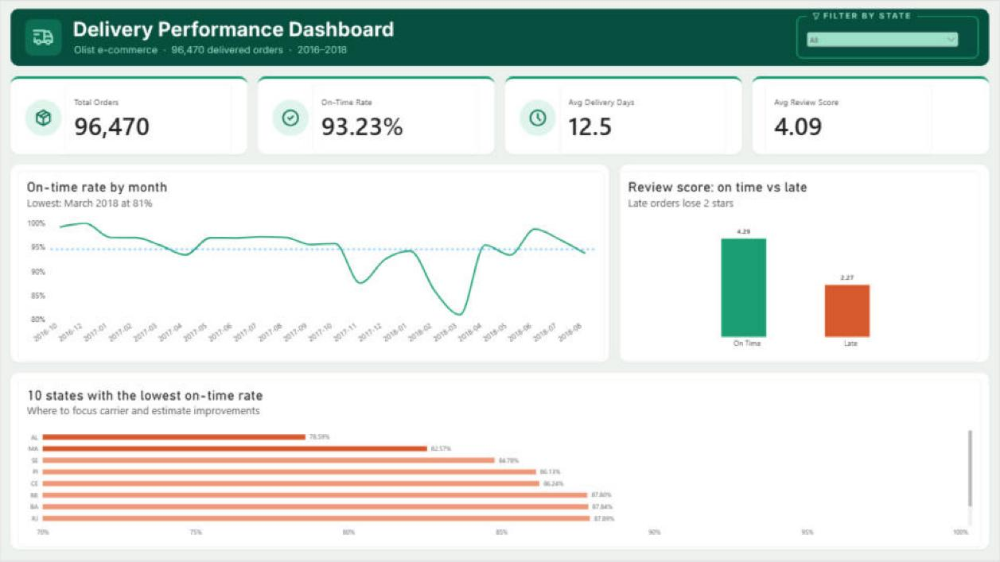

# Olist Delivery Performance Analysis (Power BI)

I wanted to practice on real logistics data, so I took the public Olist e-commerce dataset from Kaggle and looked at one thing: do orders arrive when the customer was told they would, and does it matter when they don't?

## The question

Every order on Olist gets an estimated delivery date. I treated that date as the promise to the customer and checked:

- how many orders actually arrived on or before it
- how long delivery takes on average
- whether late orders get worse reviews
- when and where most of the delays happen

## Data

Brazilian E-Commerce Public Dataset by Olist (Kaggle), about 100k orders from 2016 to 2018. I only used three of the nine files:

- `olist_orders_dataset.csv`
- `olist_customers_dataset.csv`
- `olist_order_reviews_dataset.csv`

After cleaning I was left with 96,470 delivered orders.

## What I did

1. **Cleaning (Power Query):** kept delivered orders only, removed rows with no delivery date, fixed the date columns and dropped columns I didn't need.
2. **Model:** linked customers to orders and orders to reviews.
3. **Calculated columns (DAX):** delivery days, days vs. estimate, a simple On Time / Late flag, and purchase month.
4. **Measures (DAX):** total orders, late orders, on-time rate, average delivery days, average review score.
5. **Dashboard:** KPI cards, on-time rate by month (with the average line), review score for on-time vs. late orders, and the 10 states with the lowest on-time rate. There's a state filter at the top.

An order counts as late if it was delivered after the estimated date. Other projects on this dataset define it differently, so the numbers won't always match.

## What I found

| | |
|---|---|
| Orders analyzed | 96,470 |
| On-time rate | 93.2% |
| Average delivery time | 12.5 days |
| Average review score | 4.1 / 5 |

- **Late orders get much worse reviews.** 4.29 stars on average when on time, 2.27 when late. That's the finding that surprised me most.
- **Performance drops in busy periods.** March 2018 was the worst month at 81% on time and 16.2 days average delivery. There's a smaller dip around November 2017.
- **A few states drag the average down.** AL (78.6%) and MA (82.6%) had the lowest on-time rates.

## What I'd suggest

- Plan extra carrier capacity before peak months, or give a more realistic estimate in those months.
- Look at the carriers and estimates for the weakest states first.
- Tell customers early when an order is going to be late, since a late order costs about two stars.
- Track the on-time rate monthly and flag it when it drops below a set level.

## What I'd add next

- Seller data, to separate seller handling time from carrier transit time
- Product weight and size, to see if heavier items are late more often
- A map view by state

## Files

- `Olist.pbix` – Power BI report
- `dashboard.png` – screenshot of the dashboard

Tools: Power BI, Power Query, DAX
